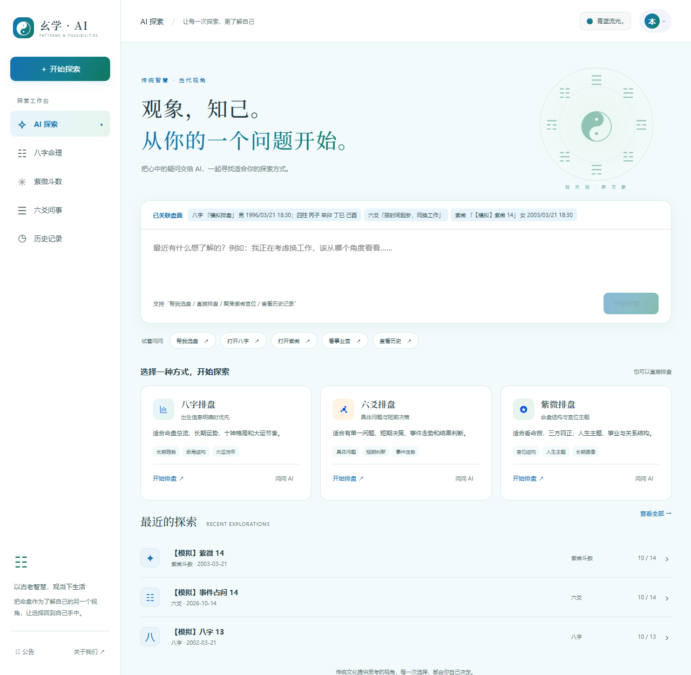
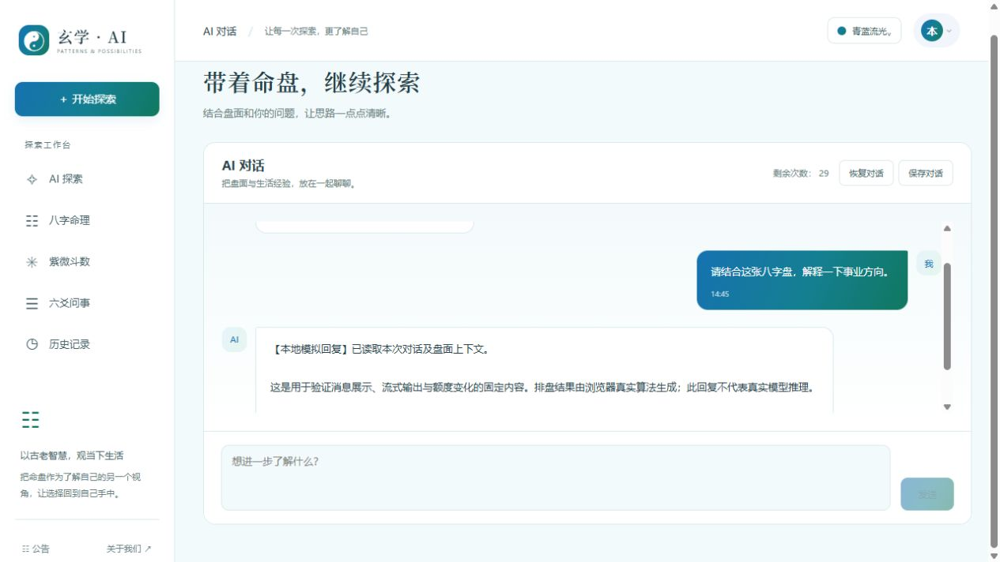
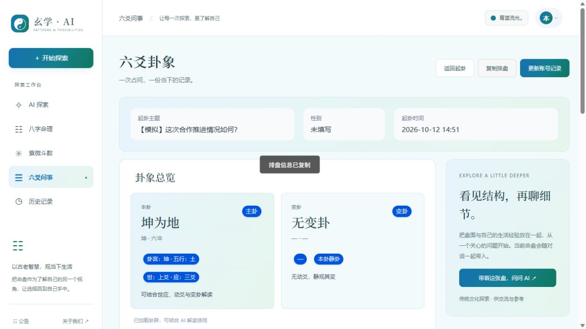
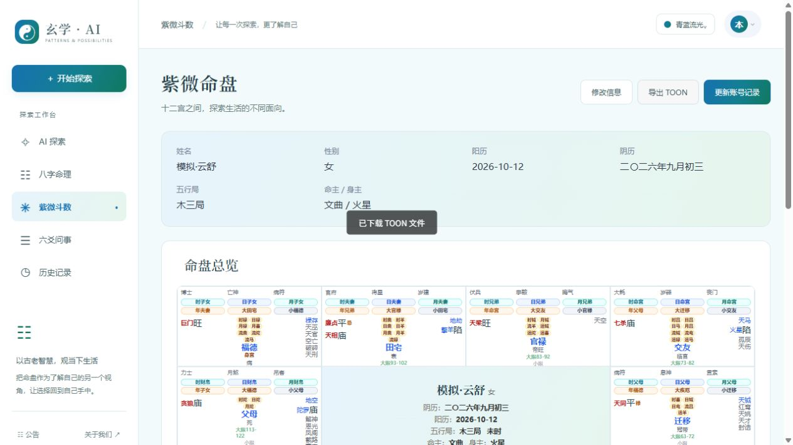
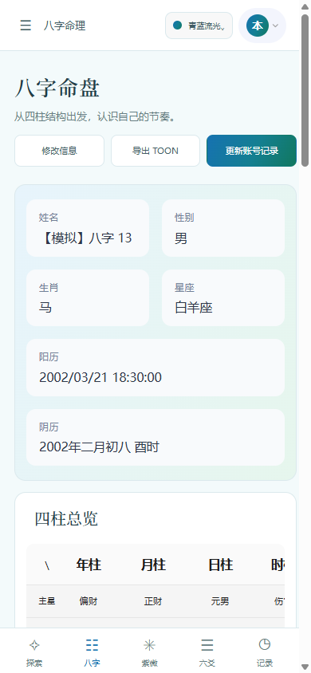
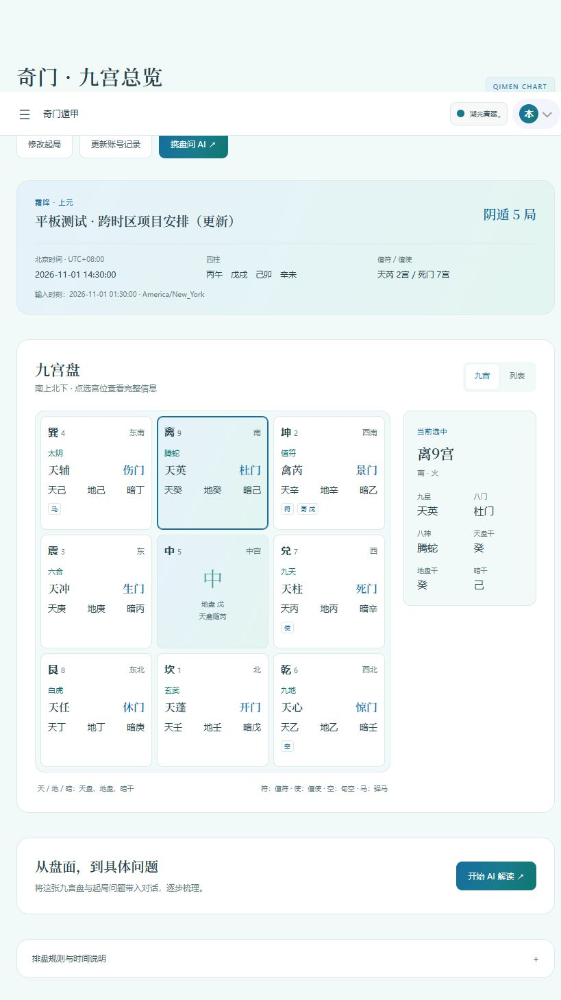

# 玄学AI Chat & Agent

支持**八字、六爻、紫微斗数、奇门遁甲**的排盘与 AI 对话应用。`main` 分支包含用户前端、Express 后端、MySQL 数据存储及管理端，覆盖排盘、记录保存、历史回放、AI 解读和额度管理。

纯前端体验版及其部署、模型设置说明见 [`frontend` 分支](https://github.com/mana-feng/xuan_agent/tree/frontend)，在线入口为 [xuan.manafeng.com](https://xuan.manafeng.com/)。Pages 仅发布 `frontend` 分支；下文介绍 `main` 的完整前后端。

[核心功能](#核心功能) · [项目结构](#项目结构) · [快速开始](#快速开始) · [Docker 部署](#docker-部署) · [测试与验证](#测试与验证) · [界面预览](#界面预览)

## 核心功能

| 模块 | 当前功能 |
| --- | --- |
| 八字 | 四柱、十神、大运流年；保存、编辑、回放与 AI 解读 |
| 六爻 | 多种起卦方式、图形卡片选择手工爻象、统一卦爻预览、问题记录、结果导出与 AI 解读 |
| 紫微斗数 | 十二宫、星曜、运限展示；公历/农历输入与闰月处理 |
| 奇门遁甲 | 时家转盘·符头拆补，九宫、九星、八门、八神、天地盘及暗干；记录保存、历史回放和 AI 解读 |
| AI Agent | 通过自然语言选择排盘工具、导航或执行受支持的排盘动作；结合当前排盘继续对话 |
| 聊天 | 流式回复、额度与错误提示、关联原盘入口、本地会话自动保存，以及保存/恢复/清空对话 |
| 用户与记录 | 邮箱验证码注册、登录、令牌刷新；四类排盘记录在 MySQL 中按用户保存 |
| 管理端 | 用户、记录、LLM、调用额度、额度重置、SMTP 邮件、公告与访问统计 |

用户界面采用统一工作台、响应式导航及卡片布局，支持配色切换。四类排盘共用时间展示卡片和日期时间选择组件，支持数字输入、日期校验与越界值回填；公历/农历、时区等选项按各排盘规则提供。

### 时间与排盘规则

- 时间输入与计算规则分开保存、展示；涉及明确时区的输入使用 IANA 时区，并处理夏令时不存在或重复的时刻。
- 奇门按北京时间 `UTC+08:00` 计算，采用 `23:00` 换日和精确节气交接；中五寄坤二、天禽随芮。结果页可展开查看输入时间、采用的规则与引擎版本。
- 排盘计算在前端完成，服务端负责认证、用户记录、模型调用和额度。算法边界与独立基准对比材料见下方「测试与验证」。

### 记录与聊天保存

登录后保存的排盘记录写入 MySQL，支持历史检索、回放和更新；结果可复制或导出为 TOON。聊天页展示所关联的排盘，并提供返回原盘入口。

聊天会话在当前设备加密保存，按账号与排盘身份隔离，保存期为 30 天。页面显示保存状态和失败重试入口；这与服务端排盘记录是两种存储。浏览器清理站点数据、切换浏览器或站点来源会影响本地会话，文件恢复也受档案格式和会话范围校验约束。

## 项目结构

```text
.
├── backend-docker/                  # Express API、MySQL、认证与模型代理
│   ├── admin-ui/                    # 管理端，独立安装与启动
│   ├── routes/                      # 认证、四类排盘记录、模型及管理接口
│   ├── services/                    # 模型协议、额度事务与邮件服务
│   ├── websocket/                   # WebSocket 聊天服务
│   ├── tests/                       # 后端回归测试
│   ├── init-mysql.sql               # 数据库初始化脚本
│   └── .env.example
├── frontend-docker/                 # uni-app 用户前端
│   ├── src/features/                # Agent、历史、六爻、奇门及工作台功能
│   ├── src/pages/                   # 排盘、聊天、账号及历史页面
│   ├── src/chat/                    # 聊天面板、会话快照与恢复
│   ├── src/components/form/         # 共享时间卡片和日期时间弹窗
│   ├── src/store/                   # 四类排盘及用户状态
│   ├── vendor/qfdk-qimen/           # 固定版本的奇门计算引擎
│   ├── tests/                       # 算法、API 契约、会话与交互回归
│   ├── scripts/ui-simulation/       # 正式页面的本地模拟 API 运行器
│   └── ui-draft/                    # 独立 UI 草稿
├── docs/                            # 算法对比、界面和真实服务验证证据
├── screenshots/                     # 早期界面截图
└── docker-compose.deploy.example.yml # 容器部署模板
```

技术栈：Vue 3、TypeScript、uni-app、Pinia；Node.js、Express、MySQL；`lunar-javascript`、`iztro` 与本地固定版本奇门引擎。模型适配包括 OpenAI 兼容接口、Anthropic、Gemini 和 Ollama。

## 快速开始

### 环境准备

使用 **Node.js 22、npm、MySQL 8.0+**；容器部署另需 Docker 与 Docker Compose。各子项目独立安装依赖，根目录不是统一的前端安装入口。

以下命令分别从仓库根目录开始执行。已存在的 `.env` 应保留，按模板补齐配置即可；真实密钥、依赖缓存和构建产物已由 Git 忽略。

### 启动后端

先启动 MySQL，再准备后端：

```sh
cd backend-docker
npm ci
cp .env.example .env
# 编辑 .env 后启动
npm run dev
```

至少核对以下配置（模板中存在占位值，不能直接作为完成配置）：

| 配置 | 本地开发说明 |
| --- | --- |
| `NODE_ENV` / `PORT` | 使用 `development`；API 端口通常为 `3001` |
| `DB_HOST` / `DB_PORT` / `DB_USER` / `DB_PASS` / `DB_NAME` | 填写可连接的 MySQL；启动时会尝试创建数据库及初始化表，需要相应权限 |
| `JWT_SECRET` / `API_SIGNATURE_SECRET` | 分别设置随机值，至少 32 字符；签名值需与两套完整版前端配置一致 |
| `API_SIGNATURE_ENABLED` | 设置为 `true` 启用服务端签名校验 |
| `CORS_ORIGINS` / `ALLOWED_HOSTS` | 包含实际使用的站点来源和主机；使用 `127.0.0.1` 时也要配置对应来源 |
| `COOKIE_SECURE` | 本地 HTTP 为 `false`；生产 HTTPS 为 `true` |
| `ALLOW_INSECURE_SECRETS` | 设为 `false`，并替换示例密钥 |
| `ADMIN_USERNAME` / `ADMIN_EMAIL` / `ADMIN_PASSWORD` | 用于启动时初始化或同步管理员账号，自行设置凭据 |
| `SKIP_DB` | 正常使用设为 `false`；跳过数据库不能验证登录、服务端保存或 AI 额度 |

后端地址为 <http://127.0.0.1:3001>，健康检查为 `/api/health`。数据库连接失败时后端可能以降级模式继续监听，业务接口返回 `503`；健康检查成功不代表登录、数据库和模型已经可用。

### 启动用户前端与管理端

在两个终端分别运行：

```sh
# 用户前端
cd frontend-docker
npm ci
cp .env.example .env
# 按下表修改 .env
npm run dev:h5
```

```sh
# 管理端
cd backend-docker/admin-ui
npm ci
cp .env.example .env
# 按下表修改 .env
npm run dev:h5
```

两者均通过 Vite 配置 `/api` 代理，本地 H5 可使用以下设置：

| 配置 | 用户前端 | 管理端 |
| --- | --- | --- |
| `VITE_DEV_PORT` | `3000` | `3002` |
| `VITE_API_BASE_URL` | `http://127.0.0.1:3000` | `http://127.0.0.1:3002` |
| `VITE_API_PROXY_TARGET` | `http://127.0.0.1:3001` | `http://127.0.0.1:3001` |
| `VITE_API_SIGNATURE_ENABLED` | `true` | `true` |
| `VITE_API_SIGNATURE_SECRET` | 与后端 `API_SIGNATURE_SECRET` 一致 | 与后端 `API_SIGNATURE_SECRET` 一致 |
| `VITE_CSP_ALLOW_UNSAFE_STYLE_INLINE` | 本地开发设为 `true`，允许组件内联样式 | 同左 |

当前代码读取的是 `API_SIGNATURE_ENABLED` / `VITE_API_SIGNATURE_ENABLED`；部分模板仍出现 `*_DISABLED`，配置时请显式使用上表中的启用字段。`VITE_*` 是构建期配置，修改后需要重启开发服务或重新构建。

访问用户端 <http://127.0.0.1:3000> 和管理端 <http://127.0.0.1:3002>。管理端登录后先配置邮件服务（普通用户注册需要邮箱验证码）、模型服务和额度。

完整版由**后端**访问模型。Ollama 适配使用原生 `/api/chat`，可填写服务根地址或完整 `/api/chat` 地址，允许无 API Key。其他提供商按管理页填写接口、模型和鉴权信息。容器中的 `127.0.0.1` 指向容器自身，模型地址须从后端所在网络可达。

后端模型超时默认 180 秒；完整版用户前端 `VITE_LLM_REQUEST_TIMEOUT_MS` 默认 195 秒，Nginx `/api` 代理读取超时为 195 秒。调整后端 `LLM_REQUEST_TIMEOUT_MS` 时同步调整客户端与代理。

## 认证与模型请求

后端使用 JWT 访问令牌与刷新令牌、邮箱验证码、按用户隔离的记录接口和额度事务。注册验证码消费与令牌轮换使用事务处理；HTTP / WebSocket 模型请求统一处理超时、取消、空响应和不完整流，失败时释放预留额度。

CORS、Host 校验、请求签名、限流和 CSP 需结合部署环境配置。浏览器端的 `VITE_*` 配置会进入静态构建产物，不应填入后端 JWT 密钥或数据库密码；模型服务鉴权信息由后台管理。

## Docker 部署

```sh
cp docker-compose.deploy.example.yml docker-compose.deploy.yml
# 修改镜像、平台、域名和所有 CHANGE_ME 占位值后执行
docker compose -f docker-compose.deploy.yml pull
docker compose -f docker-compose.deploy.yml up -d
```

模板使用预构建镜像，**不会自动构建当前工作目录的代码**。部署前请检查：

- 将 `yourdockerhub/...` 替换为自己的镜像；三个 Dockerfile 分别位于 `backend-docker`、`frontend-docker` 和 `backend-docker/admin-ui`。
- 模板平台为 `linux/arm64`；按镜像和服务器实际架构调整。
- 后端 `DB_PASS` 与 MySQL 对应账号密码必须一致；模板使用 root，因此需同时修改 `MYSQL_ROOT_PASSWORD`。
- 配置真实域名、CORS、管理员凭据、随机密钥及 HTTPS；按当前代码显式设置 `API_SIGNATURE_ENABLED=true`。仅做本地 HTTP 测试时，需将模板的 `COOKIE_SECURE` 调整为 `false`。
- 前端 `VITE_*` 在构建时生效；仅修改已启动容器的环境变量不会改写静态页面中的配置。现有 Dockerfile 的 Node 基础镜像仍为 `node:18-alpine`，与上述本地开发版本不同，容器构建需单独验证。

默认容器访问地址：用户端 <http://127.0.0.1:3000>、管理端 <http://127.0.0.1:3001>；后端 API 在容器网络内通过 Nginx 代理访问。MySQL 使用 `db_data` 卷保存数据。

## 测试与验证

安装依赖后，从仓库根目录运行：

```sh
# 用户前端
npm --prefix frontend-docker test
npm --prefix frontend-docker run typecheck
npm --prefix frontend-docker run build:h5

# 管理端
npm --prefix backend-docker/admin-ui run typecheck
npm --prefix backend-docker/admin-ui run build:h5

# 后端尚未定义 npm test，使用 Node 测试入口
cd backend-docker
node --test tests/*.test.cjs
```

各完整版模块还提供 `lint` 脚本；后端 ESLint 配置依赖 `frontend-docker` 中的插件，先安装用户前端依赖。单元及受控接口测试不等于真实数据库、模型、浏览器或容器验收；H5 验证也不代表小程序和 App 已验证。

### 正式页面的模拟环境

需要先检查界面和交互、暂不连接数据库与模型时：

```sh
cd frontend-docker
npm run dev:simulation
```

默认页面为 <http://127.0.0.1:4174>，场景控制台为 <http://127.0.0.1:4318>。模拟环境使用正式页面，提供延迟、空历史、未登录、额度不足、服务失败和流中断等场景；账号、记录与 AI 回复为测试数据。启动参数、测试账号与行为说明见 [模拟运行器说明](frontend-docker/scripts/ui-simulation/README.md)。

独立设计草稿可通过 `npm --prefix frontend-docker run dev:ui-draft` 启动，详见 [UI 草稿说明](frontend-docker/ui-draft/README.md)。

### 已归档的验证资料

- [紫微与奇门算法检查报告](docs/algorithm-audit/report.html)：历法边界、规则说明与修复记录。
- [独立算法基准材料](docs/algorithm-benchmark-2026-10-13/)：紫微、奇门、时区和天文计算等对照数据。
- [真实服务验证报告](docs/qimen-live-evidence-2026-10-13/index.html)：登录、奇门保存与回放、AI 回复、额度和失败场景。
- [正式页面 UI 证据](docs/ui-production-evidence/) 与 [导航适配证据](docs/ui-navigation-evidence/)：不同屏幕尺寸的截图及交互记录。

这些资料保留各次验证的日期、环境与范围；历史通过数不作为当前提交的实时测试结果。HTML 报告可从本地文件打开，关联证据保存在同目录。

## 界面预览

下列为仓库留存的正式页面截图，最新样式以本地运行页面为准。

| Agent 工作台 | 关联排盘的聊天 |
| --- | --- |
|  |  |

| 六爻排盘 | 紫微命盘 |
| --- | --- |
|  |  |

| 八字移动端 | 奇门九宫 |
| --- | --- |
|  |  |

## 免责声明

本项目所有内容**仅供娱乐与学习研究**，不构成任何专业建议。玄学文化源远流长，请勿过度依赖或迷信。生活中的重要决策，请结合实际情况理性判断。

## 关于对玄学的看法

### 玄学是什么

玄学这个词，在当代语境下承载了太多含义。有人把它等同于迷信，有人把它视为传统文化的瑰宝，有人用它来寻求心理安慰，也有人试图从中找到某种"规律"。

我的理解是：玄学是一套古老的认知框架。在科学方法论尚未成型的年代，古人面对充满不确定性的世界，用观察、归纳、类比的方式，试图建立一套解释万物的体系。这套体系未必经得起现代实证的检验，但它本身是一种认真的、系统的思维尝试。

### 为什么不应该简单地否定

很多人一提到玄学就嗤之以鼻，认为这是愚昧的产物。但如果你真的去读《易经》的卦辞爻辞，去研究六爻纳甲的排盘逻辑，去理解八字中天干地支的生克制化关系，你会发现这些东西并不是胡编乱造的。它们有严密的内部逻辑，有自洽的推演规则，有数千年的经验积累。

否定一个东西，至少要先了解它。不了解就否定，和不了解就盲信，本质上是一样的——都是放弃思考。

### 为什么不应该盲目地相信

反过来，把玄学当作真理来信奉，同样是有问题的。

玄学的核心困境在于：它的理论体系是封闭的、自洽的，但未必与客观世界有真实的因果关联。一个八字排盘可以告诉你"日主偏弱，喜印比"，但这个判断和一个人真实的命运之间，是否存在可验证的因果关系？目前没有任何严谨的研究能证明这一点。

更危险的是确认偏误。当玄学的解释足够模糊和灵活时，人总是能从事后找到"应验"的证据，而忽略那些没有应验的部分。这种心理机制让人越信越深，却离真实越远。

### 关于"准不准"的问题

这是被问得最多的问题。我的回答是：这个问题本身就问错了。

"准不准"隐含的前提是，玄学是一种预测工具，它的价值取决于预测的准确率。但如果你用这个标准来衡量，玄学经不起检验——没有任何玄学体系能在严格的双盲实验中表现出统计显著的预测能力。

但这不意味着玄学毫无价值。一个心理咨询师不会告诉你"你明年三月会升职"，但他帮你理清思路、缓解焦虑，这个价值是真实的。玄学的价值也不在于预测，而在于它提供了一套语言和框架，让人能够把模糊的处境具象化，把混沌的情绪结构化。

### 数据说话：玄学比赛的真实正确率

如果一定要谈"准不准"，那就用数据来说话。

目前最权威的玄学比赛是香港青年术数家协会主办的**全球算命师大赛**，已举办16届。赛制为8个命例、40道四选一选择题，有明确标准答案，由8位老师实名出题，统计时剔除最高和最低分各5题，以中间30题计最终成绩。

**历年冠军准确率：**

| 年份 | 冠军准确率 | 季军准确率 |
|------|-----------|-----------|
| 2025 | 50.0% | 45.0% |
| 2024 | ~50% | - |
| 2023 | 37.5% | 32.5% |
| 2022 | 40.0% | 35.0% |

四选一选择题，纯随机猜测的正确率是25%。冠军准确率在37.5%~50%之间，大多数年份在40%~50%。这个成绩说明命理推断确实包含一定的信息量——毕竟显著高于随机基线——但远未达到"神断"的程度。

**AI大模型的表现：** 基于BaziQA基准测试（200道大赛真题），主流大模型的准确率在32%~40%之间，同样显著高于25%的随机基线，但低于人类冠军。搭载结构化推理协议的专用命理AI可达42%。一个有意思的发现是：主打逻辑推理的模型在八字测试中反而略逊于对话版，说明命理推理不完全等同于数学逻辑，它更依赖对语境和传统语义的深层理解。

这些数据印证了一个判断：玄学不是纯粹的随机游戏，但也绝不是可靠的预测工具。它处于"比瞎猜好，但远不够精确"的区间。这个区间恰好对应了它的合理定位——一种辅助思考的框架，而非决策的依据。

### AI在玄学领域的真正意义

AI擅长的是模式识别和概率计算。而玄学本质上也是一套基于模式的推演体系——天干地支的组合、五行的生克、卦象的变化，这些都可以被形式化、被编码。所以用技术来实现排盘、来辅助解读，是完全可行的，甚至比人工更精确、更高效。但这是AI在玄学中最浅层的价值。

AI与人类卦师的根本区别在于：人类卦师的解读往往带有浓烈的个人倾向，主观且极易被偏见、鬼神、恐惧所影响。而AI的回答本质上是transformer模型在多头注意力机制下，基于训练数据通过概率计算得出的"基本客观"的结果。同时，token的价格极其低廉甚至免费，不会像人类卦师那样给求卦者带来经济负担。

那么，大多数人求玄学的真正需求是什么？我个人武断地猜测，超过80%对玄学（八字、星座、风水、教派等）感兴趣的普通人，基本都是希望通过"预测未来"来了解自己的未来、寻找心理或身体上的依靠、或学习一门"极其特殊"的手艺。他们需要的不是精准的预言，而是被理解和被引导。

正因如此，AI在玄学中的真正意义不是"预测"，而是"正向引导"——与心理学的融合。大语言模型的训练过程本身就包含大量心理学资料，所以AI在解读排盘信息后，往往会提供正向引导：放宽心、灵活应变、保持独立思考。这些建议就像一位专业的心理咨询师或稳重见多识广的长辈，帮你了解现状、理清头绪、安抚情绪。相较于对玄学信息的训练和预测，心理学的引导才应该是一个解卦AI的核心。

对于那些正在经历挫折和迷茫的人，一个客观理性、不会为了私利而散播恐惧（如血光之灾、花钱消灾、子女克亲、风水恐吓、鬼魂附身等）的AI，才是真正值得的选择。

### 关于宿命论

宿命论是玄学的主要基础，它认为一个人的未来和过去都是确定的，不能或很难被改变。也正因此，才诞生了八字、紫微、六爻等对于命运和未来的预测工具。

但这个概念一直是一项很模糊的概念，虽然很多年以来一直被讨论、研究，但实际很少有人能够对它进行准确的定义。它是一个基于个人经验、个人直觉、个人理解的概念，而不是一个科学的理论。

#### 来自现代科学的宿命论视角

宿命论并非只有玄学在讨论。现代科学界也有持有类似观点的学者。

OpenAI核心工程师翁佳毅（Jiayi Weng）认为，人类没有自由意志，我们生活在一个确定性的马尔可夫过程里。从宇宙大爆炸的那一刻起，世界上发生的所有事情，包括每个人下一秒会想什么、说什么，都已经被预设好了。基于这种宿命论，他认为所有的东西理论上都是可以被AI预测和解决的。但他同时也认为，如果真的出现了一台能够预测未来的AI机器，这对人类社会将是一场灾难，会导致人类现有的价值体系全面崩塌。面对这种认知，他选择在日常生活中"忘记"这种认知，专注于体验当下的生活。

斯坦福大学神经生物学教授罗伯特·萨波尔斯基（Robert Sapolsky）在其著作《命定》（Determined: A Science of Life Without Free Will）中提出了更为系统的"生物决定论"。他认为，我们以为的"自由选择"，其实是大脑在生物学和环境因素层层叠加下产生的必然结果。他将决定行为的因素拆解为一条无缝的因果链条：从几秒前的神经元放电，到几小时前的激素水平，到童年期的家庭环境，到受精时刻的基因蓝图，再到几百万年前的文化与演化模式。每一个环节都不是我们自己能控制的。

萨波尔斯基指出，哪怕是后天的努力、自律和坚持，也源于良好的营养、温暖的家庭支持、以及被环境塑造出的强大前额叶皮层。一个取得巨大成就的人，只是因为他中了基因和环境的双重"彩票"。

#### 反对宿命论的声音

有支持，自然也有反对。

**量子力学的随机性：** 决定论的前提是"宇宙是确定性的"。但量子力学表明，微观层面存在真正的随机性（如海森堡不确定性原理）。如果底层物理世界不是完全确定的，那么"宇宙大爆炸那一刻就预设了一切"的论据就不成立。虽然量子随机性不等于自由意志，但它打破了严格的因果决定论。

**涌现论（Emergence）：** 涌现论认为，复杂系统会涌现出无法从底层组分推导出的新性质。就像水分子的"湿"无法从单个H2O分子推导出来一样，"自由意志"可能是大脑这个复杂系统涌现出的高层属性，不能简单还原为神经元放电和基因。

**兼容论（Compatibilism）：** 哲学家丹尼尔·丹尼特（Daniel Dennett）在《自由的进化》（Freedom Evolves）中论证，自由意志和决定论并不矛盾。他重新定义了"自由意志"——它不是超自然的、脱离因果的能力，而是人类进化出的理性思考、预见后果、自我控制的能力。这种自由意志是真实的、有意义的，即使底层是物理决定的。

**神经科学的争议：** 萨波尔斯基的核心论据之一是利贝特实验（Libet experiment）。这个实验的操作很简单：让被试者看着一个时钟，当他们想按按钮时就按，同时记录下自己"决定要按"的那个瞬间。实验发现，在大脑运动皮层开始放电（称为"准备电位"）之后约350毫秒，被试者才意识到自己做出了决定。萨波尔斯基据此认为，大脑在你"意识到"之前就已经做了决定，所以自由意志是幻觉。

但这个实验存在大量争议。首先，"准备电位"只是大脑进入准备状态，并不等同于"已经做出决定"。就像你准备出门，不代表你已经决定了要走。后续研究（如Soon et al., 2008）虽然能提前数秒预测被试者的选择，但预测准确率仅约60%，远非100%确定。

其次，神经学家Alfred Mele指出，利贝特实验中被试者最后时刻仍有"否决权"（free won't）——即使大脑已经开始准备，人仍然可以在最后一刻选择不按。这说明意识并非完全被动。

最关键的是，利贝特实验测量的是"什么时候按按钮"这种无意义的随机选择，不涉及任何价值判断、道德考量或长期规划。把这种简单动作的神经机制推广到"你选择什么职业"、"你是否原谅一个人"、"你如何面对困境"等复杂人生决策，是严重的逻辑跳跃。就像用测量手指反射速度的实验来研究人类的道德判断一样，工具和研究对象根本不匹配。

**实用主义立场：** 即使自由意志在形而上学层面不存在，它在实践层面是必要的。法律体系、道德责任、个人成长都建立在"人有选择能力"的前提上。放弃这个前提，社会秩序会崩塌——正如翁佳毅自己也承认，预测未来的AI会导致价值体系崩塌。

#### 宿命论的危险

这些观点在科学上或许有其论据，但如果将其作为生活信条，会带来严重的后果。

宿命论最大的危险在于它会成为自我实现的预言。当你相信"我就是这样的人"、"我的命就是这样"时，你会不自觉地放弃尝试、降低期望、停止成长。然后当结果不如预期时，你会说"看吧，果然如此"——但你没有意识到，正是你的信念促成了这个结果。

这是一种认知陷阱。它让人把可能性当成了必然性，把倾向当成了判决。

#### 更合理的态度

更合理的态度是：承认先天条件的影响，但不把它当作决定论。

你的性格有先天成分，但性格可以通过自我认知和行为调整来改变；你的成长环境会影响你的起点，但起点不等于终点；某些人生节点可能更容易遇到特定类型的挑战，但如何应对这些挑战，始终是你的选择。命理可以告诉你"你可能在某个阶段更容易遇到感情问题"，但它不能决定"你一定会离婚"。前者是一种风险提示，后者是一种宿命论断。两者的区别，决定了你是被它束缚，还是被它启发。

传统命理学本身就包含了"命"与"运"两个维度。"命"是先天的、相对固定的部分；"运"是后天的、动态变化的部分。如果一切都是宿命，那么"运"这个概念就没有存在的必要。命理体系自身就承认了变化、流动和可能性。

命不是剧本，而是地图。地图告诉你地形，但怎么走，是你自己的事。

### 最后

玄学不是科学，但也不是毫无价值的糟粕。它是一种古老的智慧形态，有它的局限，也有它的独特之处。

就像现在的医学、法律、金融等，这些领域直到如今都没有人能够对任何事物完全确定，之前被奉为圭准的新发现，在几十年后也可能会被推翻；被几十亿人遵行的法律，也会因为新的发现和民情而被重新评估。

医学史上，胃溃疡曾被认为是压力和辛辣食物导致的，治疗方案是调整饮食和减压。直到1980年代，两位澳大利亚医生发现真正的病因是幽门螺杆菌感染，这一发现最初被学界嘲笑和忽视，多年后才被接受，并获得了2005年诺贝尔奖。曾经的标准治疗被彻底推翻。更极端的例子是，脑叶白质切除术（lobotomy）曾获得1949年诺贝尔生理学或医学奖，被广泛用于治疗精神疾病，如今被视为医学史上最黑暗的篇章之一。

法律领域同样如此。奴隶制曾在数千年里被法律保护和道德接受，如今被普遍视为反人类罪行。美国的种族隔离法曾被认为是合宪的，直到1954年布朗诉教育委员会案才被推翻。同性婚姻在21世纪初的绝大多数国家都是非法的，如今已在三十多个国家合法化。这些曾经"确定无疑"的法律共识，在几十年内被彻底颠覆。

金融领域也不例外。有效市场假说曾长期被视为金融学的基石，认为市场价格总是反映所有可用信息，直到行为金融学用大量实证数据证明市场充满非理性偏差。2008年全球金融危机彻底暴露了"大而不能倒"机构的脆弱性，而此前这些机构的风险模型被奉为精确科学。金本位制曾被认为是货币体系的根基，如今已被所有主要经济体放弃。

保持好奇、保持怀疑、保持独立思考，是对待任何事物的最合理的态度，也是铺垫和促进玄学这一知识体系发展的底层基础和动力。

## 贡献指南

欢迎提交 Issue 和 Pull Request！

- **Bug 反馈**：请附上问题描述、复现步骤、平台信息及截图
- **功能建议**：请说明使用场景和期望效果
- **代码贡献**：提交前运行相关回归测试、类型检查、lint 与 H5 构建，并注明真实服务或浏览器验证的范围

## 许可证

本项目采用 GNU Affero General Public License v3.0 (AGPL-3.0) 许可证。

## 鸣谢

- [toon-format/toon](https://github.com/toon-format/toon) - Token-Oriented Object Notation
- [axbug/8Char-Uni-App](https://github.com/axbug/8Char-Uni-App) - 基于 Uni-APP 的八字排盘工具
- [OpenAI Codex](https://github.com/openai/codex) - AI 编程助手
- [Qwen](https://github.com/QwenLM/Qwen) - 通义千问大语言模型
